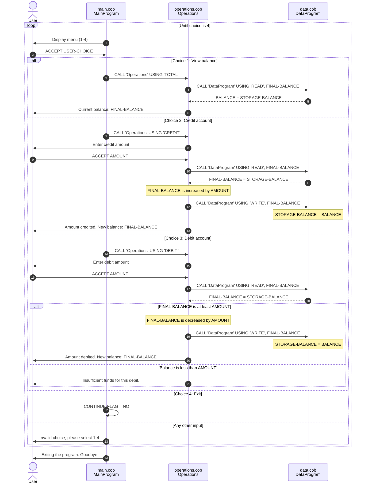

# Legacy COBOL Account Management System

This document describes the COBOL source in [src/cobol/](../src/cobol/): the purpose of each program, its key paragraphs and data items, and the business rules that govern account balances.

## Overview

The application is a small interactive console program that manages a single account balance. It presents a menu, lets the user view the balance or credit/debit it, and stores the balance in a separate data program that persists it for the life of the process.

```
main.cob  (MainProgram)     menu and user input
    │
    └── CALL 'Operations'   business operations (TOTAL, CREDIT, DEBIT)
            │
            └── CALL 'DataProgram'   balance storage (READ, WRITE)
```

## Source Files

| File | Program ID | Role |
|------|------------|------|
| [main.cob](../src/cobol/main.cob) | `MainProgram` | Entry point. Displays the menu and dispatches the user's choice. |
| [operations.cob](../src/cobol/operations.cob) | `Operations` | Implements the View, Credit, and Debit operations and enforces the funds check. |
| [data.cob](../src/cobol/data.cob) | `DataProgram` | Holds the stored balance and provides READ and WRITE access to it. |

### main.cob — `MainProgram`

Controls the main loop.

- **`MAIN-LOGIC`**: Loops until `CONTINUE-FLAG` is `'NO'`. Each pass displays the menu, accepts a choice into `USER-CHOICE`, and evaluates it:
  - `1` → `CALL 'Operations' USING 'TOTAL '` (view balance)
  - `2` → `CALL 'Operations' USING 'CREDIT'`
  - `3` → `CALL 'Operations' USING 'DEBIT '`
  - `4` → sets `CONTINUE-FLAG` to `'NO'` and exits
  - any other value → displays `Invalid choice, please select 1-4.`
- Displays a goodbye message and runs `STOP RUN`.

**Working storage**

| Item | PIC | Purpose |
|------|-----|---------|
| `USER-CHOICE` | `9` | Menu selection |
| `CONTINUE-FLAG` | `X(3)` | Loop control (`YES` / `NO`) |

### operations.cob — `Operations`

Receives a six-character operation code and performs the matching business operation. It never touches storage directly; it always goes through `DataProgram`.

- **`TOTAL `**: Reads the balance from `DataProgram` and displays `Current balance:`.
- **`CREDIT`**: Prompts for an amount, reads the current balance, adds the amount, writes the new balance back, and displays the result.
- **`DEBIT `**: Prompts for an amount, reads the current balance, and:
  - if `FINAL-BALANCE >= AMOUNT`, subtracts the amount, writes the new balance, and displays the result;
  - otherwise displays `Insufficient funds for this debit.` and leaves the balance unchanged.

**Working storage**

| Item | PIC | Purpose |
|------|-----|---------|
| `OPERATION-TYPE` | `X(6)` | Local copy of the requested operation |
| `AMOUNT` | `9(6)V99` | Amount entered by the user for a credit or debit |
| `FINAL-BALANCE` | `9(6)V99` | Working copy of the balance. Its `VALUE 1000.00` is overwritten by every `READ` before use, so it has no effect. |

**Linkage**: `PASSED-OPERATION X(6)`.

### data.cob — `DataProgram`

A minimal storage layer. The balance lives only in its working storage.

- **`READ`**: copies `STORAGE-BALANCE` into the caller's `BALANCE` argument.
- **`WRITE`**: copies the caller's `BALANCE` argument into `STORAGE-BALANCE`.
- Any other operation code is ignored.

**Working storage**

| Item | PIC | Purpose |
|------|-----|---------|
| `STORAGE-BALANCE` | `9(6)V99` | The persisted balance. Initialised to `1000.00`. |
| `OPERATION-TYPE` | `X(6)` | Local copy of the requested operation |

**Linkage**: `PASSED-OPERATION X(6)`, `BALANCE 9(6)V99`.

## Business Rules

These rules are taken directly from the code.

### Account balance

1. **Opening balance is 1000.00.** `STORAGE-BALANCE` in [data.cob](../src/cobol/data.cob) starts at `1000.00`. Because the storage is in memory, the balance resets to 1000.00 every time the program starts. No data is saved between runs.
2. **There is a single account.** No account number, customer ID, or student ID is used. All operations act on the same balance.
3. **Balance range.** Balances are unsigned `9(6)V99`, so they are stored as 0.00 to 999,999.99. The balance cannot go negative.

### Credits

4. **Credits add to the balance.** The amount is added to the balance and the new balance is written back.
5. **Credits are not validated.** The program does not check that the amount is positive, non-zero, or within a business limit.

### Debits

6. **No overdraft.** A debit succeeds only when `balance >= amount`. A debit that would take the balance below zero is refused with `Insufficient funds for this debit.` The balance is not changed.
7. **A debit equal to the full balance is allowed.** The check uses `>=`, so the balance can reach exactly 0.00.
8. **Debits are not validated for zero or non-numeric input** for the same reason as credits (rule 5).

### Menu

9. **Valid choices are 1 through 4.** Any other input shows an error and the menu is redisplayed.

## Discrepancy with Project Description

The step guide in [.github/steps/2-explain-legacy-code.md](../.github/steps/2-explain-legacy-code.md) describes the system as managing student accounts, with menu options for viewing a student balance, processing a payment, and recording a purchase. The code does not implement any of this:

- The menu offers generic **Credit** and **Debit** operations, not payment or purchase recording.
- There is no student identifier, fee schedule, cafeteria or supplies logic, or per-student balance.
- The only account-specific rules are the ones listed above.

The business rules that apply to student accounts therefore cannot be found in this code. If student-level behaviour is required, it must be specified separately and added, because it is not present in the current implementation.

## Running the Program

The three sources are compiled together into one executable. With a COBOL compiler such as GnuCOBOL installed:

```
cobc -x -o account src/cobol/main.cob src/cobol/operations.cob src/cobol/data.cob
./account
```

## Known Issues

- **No input validation** on amounts (see rules 5 and 8).
- **No persistence**: the balance is reset to 1000.00 on every run.
- **Unused initial value**: `FINAL-BALANCE` in `operations.cob` has a `VALUE` clause that is never relied upon, since the balance is always read from `DataProgram` first.

## Data Flow

The sequence diagram below shows how a user request moves through the three programs. Each `CALL` passes data by reference, so `BALANCE` in `DataProgram` is the same storage as `FINAL-BALANCE` in `Operations`.


